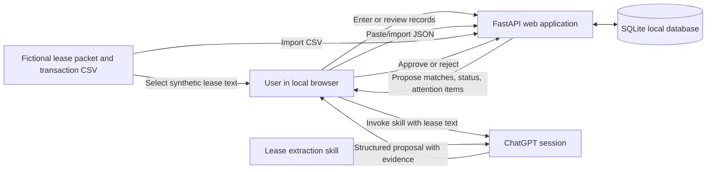

# Groundwork Workflow — Technical Design

**Status:** Implemented take-home prototype; see `EVALUATION.md` for verified behavior and limits.
**Related product brief:** [`PRODUCT_BRIEF.md`](PRODUCT_BRIEF.md)  
**Data policy:** Use fictional demo data only. Do not add family leases, bank statements, tenant information, credentials, or other private records to this repository.

## 1. Purpose

Describe the first implementation of the owner-focused property operations workflow in the product brief. The prototype should be a locally run web app that demonstrates persistent records, a reusable AI-assisted lease extraction capability, rent transaction reconciliation, and human review. It is an interview prototype, not a production property-management system.

## 2. Decisions

| Area | Decision for this prototype | Reason |
|---|---|---|
| User experience | Local web app in a desktop browser | Easy to demonstrate and inspect in an online interview |
| Backend | Python with FastAPI | Provides a straightforward backend and can serve the app's HTML pages and form submissions |
| UI | Server-rendered HTML templates with a small amount of CSS and JavaScript | Keeps the first build focused; no separate frontend application is needed |
| Persistence | SQLite file stored under an ignored local runtime-data directory | Provides real persistence without a hosted database or subscription |
| Lease AI | Reusable extraction skill invoked manually in ChatGPT; transfer structured JSON into the app | Demonstrates AI extraction and human review without requiring API billing or app-held model credentials |
| Payment input | Synthetic CSV import | Demonstrates the recurring workflow without connecting to a bank |
| Matching and date logic | Deterministic application code proposes matches and calculates status | Amounts, dates, grace periods, and duplicate handling should be predictable |
| Approval | User reviews and approves extracted terms and payment matches before records change | Keeps consequential updates under human control |
| Notifications | Calculate an in-app “Needs Attention” list when the user opens or runs a review | Demonstrates date-driven workflow without background jobs or delivery integrations |
| Email | Generate an unsent reminder draft; no email integration or sending | Keeps the prototype bounded and avoids external actions |
| Deployment | Run locally; no cloud hosting in this iteration | Keeps setup simple and avoids handling real records or deployment credentials |

## 3. Scope

### Included

- Fictional property and lease records.
- Manual entry or import of structured lease extraction proposals.
- A reusable lease-extraction skill that returns facts with page, section, and exact supporting text.
- Validation and user approval before proposed lease facts become approved terms.
- Synthetic transaction CSV import with duplicate detection.
- Deterministic rent match suggestions and payment status calculations.
- Human approval before a payment match is recorded.
- Persistent records and decision history in SQLite.
- In-app attention items for rent due/grace status and lease option or expiration dates.
- A reconciliation summary and an unsent reminder draft.

### Excluded

- Direct OpenAI or other LLM API calls from the app.
- API-key entry, provider configuration, or LLM billing management.
- Live bank, Gmail, Google Drive, or other third-party integrations.
- Sending email, making payments, or initiating any external action.
- Multi-user accounts, authentication, authorization, or production deployment.
- Real family or tenant data, production backups, and guarantees suitable for operational use.
- Automatic background scheduling, push notifications, or SMS.

## 4. Architecture



The web application owns the source-of-truth records, deterministic calculations, validation, review screens, and persistence. The ChatGPT session is a separate manual step for lease interpretation. The app never assumes that a generated proposal is approved.

### Suggested project layout

```text
app/
  main.py                 # FastAPI setup and route registration
  db.py                   # SQLite connection and initialization
  models.py               # Data structures and validation schemas
  services/
    extraction_import.py  # Validate and stage pasted extraction JSON
    reconciliation.py     # Deterministic transaction matching and status
    attention.py          # Deterministic date-driven attention items
  templates/              # Server-rendered HTML
  static/                 # Small CSS and browser-side enhancements
skills/
  lease-extraction/
    SKILL.md              # Reusable manual extraction instructions
sample-data/              # Fictional docs and CSV only
data/                     # Local runtime database; ignored by Git
```

The exact module boundaries can change during implementation if a simpler structure better fits the working code. Keep calculations and state transitions in service functions rather than embedding them in HTML templates.

## 5. Key workflows

### Property and source-document intake

The overview's **Add property from a lease** form creates manually entered property/tenant/account metadata and a source document atomically. It supports UTF-8 TXT and selectable-text PDF, preserving original bytes, SHA-256 fingerprint, media type, page count, and locally extracted text. `document_uploads` references the source row; originals remain inside the ignored SQLite database and can be downloaded through a property-scoped route. Existing properties can receive additional lease/amendment uploads. Startup does not require seeded properties for this flow.

Uploads are limited to 10 MB, 100 pages, and 500,000 extracted text characters. Scans, empty-text PDF pages, encrypted PDFs, and unsupported formats are rejected before creating records. Repeated identical creation/upload requests reuse the existing source; conflicting metadata is held for correction. Property-prefixed reference filenames avoid collisions across common filenames. Source addition never creates an approved term or obligation. PDF text is extracted with pypdf; OCR and semantic/layout guarantees are excluded.

TXT without explicit page markers is a single source page; PDF markers correspond to original pages. Extraction and validation allow the literal citation section `Page text` only on a page without numbered headings, while preserving strict numbered-section checks for the sample packet and other structured sources.

### 5.1 Lease extraction handoff

1. The user opens a fictional lease or amendment in the app and copies its text, or opens the source file separately.
2. The user invokes the lease-extraction skill in ChatGPT with the source text and the skill's instructions.
3. The skill returns a JSON proposal. Each proposed fact includes its type, value, effective date when applicable, and evidence containing page, section, and an exact source quotation. Unclear or conflicting facts are marked for review rather than guessed.
4. The user pastes the JSON into the app.
   The skill defines the exact versioned response contract. The user may copy only the JSON portion if ChatGPT adds surrounding prose; the app does not need to extract JSON from arbitrary model commentary. The demo uses live extraction rather than requiring a saved response fixture.
5. The app validates the JSON shape, checks that cited quotations occur in the available source text where possible, and stages the proposals as pending.
6. The user reviews the evidence and approves, edits, or rejects each fact.
7. Approval creates or updates the effective lease record while preserving the prior value and the review decision.

Amendments in this iteration affect new obligations and payments only. Recalculation or reopening of previously reconciled periods is out of scope; existing obligations and recorded allocations retain their approved values.

The prototype does not call a model API or transmit a document automatically. Only fictional documents are used in the demo. Manual copy/paste is the explicit boundary between the app and ChatGPT.

### 5.2 Transaction reconciliation

1. The user imports `sample-data/transactions-2026-10.csv` or another synthetic CSV matching the documented format.
2. The app validates required columns, dates, numeric amounts, and description matching candidates. Invalid rows are reported and are not silently imported.
3. The app prevents duplicate imports using the source file digest and transaction identifier where available.
4. Deterministic rules compare each transaction with expected rent by property/account, amount, date, and approved obligation. Candidates are suggestions only.
5. Transactions that appear partial, unexplained, duplicated, or ambiguous remain unresolved and appear in the review queue.
6. The user approves or rejects each match. Only approval changes the recorded payment state.
7. The app updates the reconciliation summary and retains the import and decision history.

For the first slice, the matcher should favor transparent, explainable rules over fuzzy scoring. It may suggest exact-amount and account-aligned candidates; it must not force a match when there are multiple candidates or incomplete payment evidence.

Only full payments receive automatic match proposals, and every proposal still requires approval before recording. Partial payments are handled through explicit manual allocation and approval. Approved allocations must be persisted so multiple payments can satisfy one obligation without reusing a transaction's allocated amount. An unidentified credit is not automatically combined with a partial payment simply because their total equals rent.

Implemented in slice 3: the reconciliation workspace lets the user create one obligation per property and month, retaining integer-cent amounts, due/grace rules, fact references, evidence, and assumptions. It never regenerates an existing obligation. Unreviewed amendments pause creation after their document date until applicable terms are approved; pending amendment terms also block affected months. Mid-month changes and unsupported shorter-month due-day rules are held for review. Missing approved lease start/end dates are visible assumptions rather than inferred boundaries.

CSV intake is atomic per file. It requires four columns (`transaction_id`, `posted_date`, `description`, `amount`), nonempty feed-wide transaction identifiers, valid ISO dates, descriptions, and positive decimal USD amounts. UTF-8 BOM is accepted. Identical file digests are skipped; matching identifier/date/description/amount in another file are skipped; changed details reject the whole file. Imports retain added/skipped counts and source-file fingerprints; each new transaction retains its import identity and physical source row. Uploads are limited to 2 MB and 10,000 rows. Importing does not create a match or a payment allocation; that remains slice 4.

Implemented in slice 4: an explicit matching run persists full-payment proposals and unresolved transaction issues. Only exact amounts on the same account, entirely unpaid rent, and a unique transaction/obligation pairing in the selected month receive proposals. Rejected and withdrawn proposals are retained and not recreated. Every approval rechecks eligibility and available funds inside a SQLite write transaction. Manual allocations require an explicit target and evidence note; each deposit is allocated in full once, with no splitting or overpayments. Earlier unpaid months may be selected manually; later rent months are outside scope.

Approved allocations link their review decision and retain a due/grace timing annotation. Balances derive from approved allocations; the selected review date excludes future-posted transactions from matching and recorded totals without freeing previously approved deposits for reuse. Exceptions retain original evidence/reason and append opening, update, and resolution events. A later approved payment can resolve a partial-payment balance while an unrelated credit remains open. `app/services/payments.py` holds these state transitions; CSV intake remains in `reconciliation.py`. No payment or exception is resolved merely by generating a proposal.

### 5.3 Needs Attention and reminder draft

- The user selects an explicit “as of” date, with today as the default.
- Code calculates due, within-grace, or past-grace status only from approved terms.
- Code derives lease option notice windows from approved dates and notice rules. It must not infer that an option was exercised.
- The interface distinguishes an overdue payment from a lease-defined late fee or legal consequence. It shows no fee unless a reviewed source term supports one.
- The user can prepare a neutral reminder draft from approved facts. The draft is saved or displayed for review and is never sent by this prototype.

Matching explanations, the reconciliation report, and reminder drafts are deterministic templates. Lease extraction in the separate ChatGPT session is the only runtime AI capability.

No scheduler is required. The check runs when the user opens or refreshes the relevant view.

Implemented in slice 5: `/attention` and the overview calculate rent and lease items against an explicit review date. App planning horizons (30 days for upcoming rent, 12 months for expiration, one calendar month for upcoming notice windows) are labeled separately from contractual deadlines. Beacon's approved notice window uses inclusive calendar-month arithmetic with end-of-month clamping. An optional staging action loads manually authored pending Beacon date/option proposals and a later fictional confirmation source; it never approves them automatically.

`lease_option_events` records explicitly approved exercise dates, prior/new expirations, source quotations, snapshots of supporting approved terms, and review decisions. Exercise dates must lie within the approved notice window and not follow the review date; the stated new expiration must match the approved duration. Existing obligations and rent facts are unchanged. The recorded extension supports attention planning but does not carry base rent into an extension whose rent has not been approved.

`/report` and `/report.md` generate a consistent read-only monthly brief, with approved amounts, pending transaction evidence, retained rent and lease-date citations, uncertainty, assumptions, exceptions/history, and next steps. HTML reminder drafts and Markdown export use deterministic templates. Drafts use approved balances, mention pending credits, and are never sent. No report-generation route changes approval or payment state.

## 6. Data model

Use SQLite tables with foreign keys and timestamps. Keep the first schema small, but preserve enough provenance and history to explain how each current record was established.

| Entity | Important fields | Purpose |
|---|---|---|
| `properties` | `id`, `name`, `account_label`, `created_at` | Fictional property identity and bank-account label used only to match the synthetic feed |
| `lease_documents` | `id`, `property_id`, `filename`, `document_type`, `document_date`, `text_content` or source reference | Source lease and amendment records with stable identity |
| `document_uploads` | `document_id`, original filename/bytes, media type, digest, page count | Retained local upload evidence without replacing approved terms |
| `lease_facts` | `id`, `property_id`, `document_id`, `fact_type`, `value_json`, `effective_from`, `effective_to`, `status`, `created_at` | Proposed and approved terms with effective dates |
| `fact_evidence` | `id`, `lease_fact_id`, `page`, `section`, `quote` | Exact source evidence for each proposed or approved term |
| `review_decisions` | `id`, `record_type`, `record_id`, `decision`, `reviewer_label`, `notes`, `created_at` | Approval, edit, or rejection history |
| `rent_obligations` | `id`, `property_id`, `period`, `amount_due`, `due_date`, `grace_days`, `source_fact_id` | Expected rent for a payment period, based on approved terms |
| `imports` | `id`, `filename`, `content_digest`, `imported_at`, `status` | Import/run identity and duplicate-file prevention |
| `transactions` | `id`, `external_id`, `import_id`, `property_id` or `account_label`, `posted_date`, `description`, `amount` | Synthetic incoming bank activity |
| `match_proposals` | `id`, `transaction_id`, `obligation_id`, `proposed_amount`, `status`, `rationale`, `created_at` | Candidate matches and their human-reviewed outcome |
| `payment_allocations` | `id`, `transaction_id`, `obligation_id`, `amount_cents`, `review_decision_id`, `created_at` | Approved full or partial payments; balances derive from these records |
| `exceptions` | `id`, `property_id`, `transaction_id`, `obligation_id`, `kind`, `status`, `resolution_notes`, timestamps | Unresolved issues and retained resolution history |
| `lease_option_events` | `property_id`, `option_fact_id`, `lease_end_fact_id`, `document_id`, `option_number`, `exercised_on`, `prior_expiration`, `new_expiration`, evidence/term snapshots, `review_decision_id` | Reviewed exercise history without assumed extension rent |

The initial schema may combine or simplify tables where doing so keeps the app understandable. Do not collapse source evidence and approval history into a single mutable “current value” field. A later amendment must be able to propose a new effective value while preserving the previous value and its source.

## 7. Extraction interchange format

The reusable skill should produce valid JSON, with no prose outside the JSON when practical. The app should validate a versioned schema before staging it. A representative shape is:

```json
{
  "schema_version": "1.0",
  "document_filename": "orchard-row-amendment.txt",
  "facts": [
    {
      "fact_type": "monthly_base_rent",
      "value": { "amount": 5050, "currency": "USD" },
      "effective_from": "2025-07-01",
      "effective_to": null,
      "status": "proposed",
      "uncertainty": null,
      "evidence": [
        {
          "page": 1,
          "section": "2. Revised Base Rent",
          "quote": "Effective July 1, 2025, monthly base rent is amended to $5,050.00."
        }
      ]
    }
  ]
}
```

The schema is a proposed implementation contract, not a claim that the model is always correct. Missing fields, unsupported quotes, conflicting amendments, ambiguous effective dates, and invalid JSON should result in a visible validation/review error. The user may correct the proposal before approval.

Implemented in slice 2: `app/models.py` defines the version 1.0 response; `skills/lease-extraction/contract.md` and generated `schema.json` describe it. USD amounts enter as decimal dollars and are stored as integer cents. Citation validation checks the supplied page and numbered section, tolerating whitespace differences only in quotations. The paste screen retains invalid input for correction; changes to staged facts use rejection and corrected resubmission. `extraction_submissions` retains the normalized proposal and digest to prevent repeated submissions from adding identical facts.

Approving an amendment that overlaps one earlier approved term requires an explicit replacement acknowledgement. The earlier term's value and evidence remain stored; its inclusive end date becomes the day before the replacement begins. An appended decision records its full prior value and date range. Same-start conflicts, multiple overlapping terms, and temporary overrides are blocked. Unknown effective dates remain pending and require correction before approval. The reviewer must acknowledge evidence for every approval and explain decisions involving uncertainty. No existing obligation or allocation is changed by this workflow.

## 8. Responsibilities and safeguards

### Deterministic application logic

- Parse and validate CSV rows and extraction JSON.
- Verify source quotations against known source text when available.
- Calculate due dates, grace-period status, notice windows, and amounts.
- Detect repeated imports and duplicate transaction identifiers.
- Propose transaction candidates using explicit rules.
- Persist approved records and append review history.
- Render summaries that distinguish evidence, assumptions, unresolved items, and recommendations.

### AI skill

- Extract candidate lease facts and amendment changes from unstructured text.
- Attach source page/section/quote evidence to each claim.
- Identify conflicting language and uncertainty; do not resolve unsupported legal meaning.
- Return data in the agreed JSON schema for app validation.

### Human review

- Confirm, edit, or reject extracted terms before they become active.
- Approve or reject candidate payment matches.
- Decide what to do with ambiguous or partial transactions.
- Review and edit any reminder draft outside the app; the prototype does not send it.

### Data and credential handling

- The repository contains synthetic documents and synthetic transactions only.
- The local SQLite database, environment files, and private uploads are excluded by `.gitignore`.
- No API keys are needed for this iteration. If a later iteration adds an API provider, calls must originate from the backend and credentials must be stored outside source control.
- A private GitHub repository is not a suitable place to store secrets or real lease/bank records.

## 9. Interface outline

Keep navigation and labels focused on the demo workflow:

1. **Overview:** upcoming/overdue items, unresolved transactions, and current-period summary.
2. **Properties:** list of fictional properties and approved lease facts.
3. **Lease review:** source document, pasted extraction JSON, validation messages, evidence, and approve/edit/reject controls.
4. **Reconciliation:** import CSV, inspect transactions, see suggested matches and reasons, approve/reject, and review exceptions.
5. **Report:** monthly reconciliation brief with evidence, assumptions, unresolved items, recommendations, and unsent reminder draft.

Do not expose internal implementation terminology in the app unless it helps the user make a decision. Show the source and reason for proposals in plain language.

## 10. Evaluation cases

Use the fictional fixture set in `sample-data/` to demonstrate:

- A clear Orchard Row payment for the rent amount effective after the amendment.
- The Orchard Row amendment proposing a new amount from its stated effective date, with the old amount preserved in history.
- A Beacon Industrial payment posted after its stated grace period.
- A Juniper Market partial payment plus an unattributed transaction that should remain ambiguous rather than being silently combined.
- A lease with no stated grace period, ensuring the app does not invent one.
- A Beacon extension notice window derived from the lease dates, with no assumption that the option has been exercised.
- A repeated import that does not duplicate a transaction.
- Invalid JSON or a source quote that cannot be found, which should block approval until corrected or explicitly reviewed.

Record observed results and known limitations separately from expected benefits. Do not claim real-world time savings based on the synthetic demo.

## 11. Build sequence

1. Create the app skeleton, local setup instructions, SQLite initialization, and fictional seed data.
2. Build property and approved rent views, plus manual rent/lease entry.
3. Add the lease extraction skill and JSON handoff/review flow.
4. Add synthetic CSV import, deterministic candidate matching, duplicate protection, and approval history.
5. Add Needs Attention calculations, reconciliation report, and unsent reminder draft.
6. Prepare the successful and edge-case interview walkthrough, documenting observed outcomes and limitations.

Keep each step reviewable. Before each implementation slice, explain its purpose and files; after it, summarize behavior, decisions, and any manual run steps.

## 12. Implementation choices made

- Source text is stored in SQLite, preserving page markers and stable document identity.
- Invalid pasted JSON is retained for correction. Staged proposals are rejected and resubmitted to change their values; approved history is preserved.
- The product name is “Groundwork,” with a small responsive stylesheet and server-rendered forms.
- Runtime and development dependencies are listed in the requirements files. Python 3.9.6 and the README setup/run commands were verified in a fresh virtual environment.

`DEMO_WALKTHROUGH.md` provides the rehearsal sequence and expected checkpoints. `EVALUATION.md` distinguishes automated/observed results from the unmeasured live extraction quality and remaining manual browser checks.

### Configurable property account labels

Each property has an editable primary description phrase plus explicit aliases, still stored in `properties.account_label` and `property_account_labels` for compatibility. Trim configured phrase edges and use Unicode case folding; match literal substrings of the transaction description. Do not collapse internal whitespace, use regex/fuzzy/LLM scoring, prefer the longest matching phrase, or use amount to identify property. Group matches by property: multiple aliases for the same property are one candidate. Retired phrases stop matching future imports; their ownership stays reserved. Settings changes are atomic and recorded in `review_decisions`.

`transaction_intake` retains every new valid row, its source import/row, original normalized CSV fields, candidate phrases/property IDs at import, and optional linked assigned transaction. `transaction_assignments` retains automatic/manual assignment evidence and manual review decisions. Only uniquely identified or explicitly manually assigned rows enter the existing `transactions` table. Unresolved rows are listed with original candidates and a property picker in reconciliation; they do not enter payment matching, allocations, or property ledgers. The monthly HTML/Markdown brief surfaces them separately. Manual assignment requires an existing property, supporting notes, acknowledgment, selected posted month, and a review date on/after the transaction. A SQLite write lock prevents duplicate/stale assignment. Assignment never creates a rent payment. Source descriptions and historical property/payment assignments remain unchanged when labels change.

New feed-wide transaction IDs are unique across all intake rows, including across properties, and are checked against legacy transactions. Identical dates/descriptions/amounts are skipped regardless of current phrase matching or assignment state; changed details block the entire file. Multiple legacy rows with the same identifier are retained, but attempts to import that ambiguous identifier are blocked. The existing account/property uniqueness indexes remain as additional constraints. New tables are added without rebuilding or rewriting historical transactions. The old internal transaction `account_label` field remains a compatibility snapshot, not a CSV field or ongoing eligibility test. An imported file counts both assigned and unresolved rows as imported.

### Per-property rent ledger

`/properties/{property_id}/ledger` provides a read-only ledger through a validated date. `app/services/ledger.py` reads a consistent SQLite snapshot of the property's saved obligations and approved allocations. Charge events occur on due dates; payment events occur on bank posted dates and retain the target obligation's rent month and due date, including arrears. Sort by event date, charges before payments, then stable record ID. Integer-cent running balances equal charges minus approved receipts; early payments may show a negative credit until the charge becomes due. The UI shows source transaction/review references, pending unallocated credits separately, and scheduled future obligations excluded from balances. No records, proposals, obligations, or approvals are created by viewing the ledger. Only saved base-rent obligations are covered; no historical opening balance or missing monthly charges are inferred. Through-date views use current approval decisions rather than reconstructing past reviewer knowledge. Property and overview pages link directly to separate ledgers.
