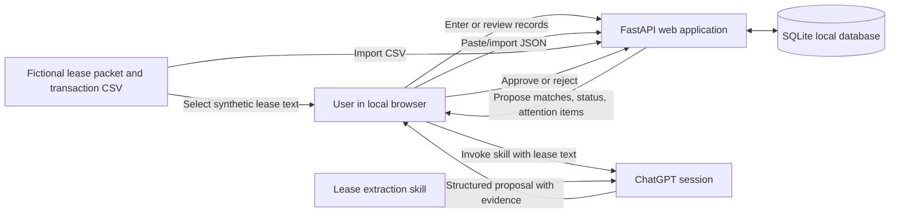

# Property Operations Workflow — Technical Design

**Status:** Draft for the take-home prototype  
**Related product brief:** [`PRODUCT_BRIEF.md`](PRODUCT_BRIEF.md)  
**Data policy:** Use fictional demo data only. Do not add family leases, bank statements, tenant information, credentials, or other private records to this repository.

## 1. Purpose

Describe the first implementation of the owner-focused property operations workflow in the product brief. The prototype should be a locally run web app that demonstrates persistent records, a reusable AI-assisted lease extraction capability, rent transaction reconciliation, and human review. It is an interview prototype, not a production property-management system.

## 2. Decisions

| Area | Decision for this prototype | Reason |
|---|---|---|
| User experience | Local web app in a desktop browser | Easy to demonstrate and inspect in an online interview |
| Backend | Python with FastAPI | Provides a straightforward backend and can serve the app's HTML pages and form submissions |
| UI | Server-rendered HTML templates with a small amount of CSS and JavaScript | Keeps the first build focused; no separate frontend application is needed |
| Persistence | SQLite file stored under an ignored local runtime-data directory | Provides real persistence without a hosted database or subscription |
| Lease AI | Reusable extraction skill invoked manually in ChatGPT; transfer structured JSON into the app | Demonstrates AI extraction and human review without requiring API billing or app-held model credentials |
| Payment input | Synthetic CSV import | Demonstrates the recurring workflow without connecting to a bank |
| Matching and date logic | Deterministic application code proposes matches and calculates status | Amounts, dates, grace periods, and duplicate handling should be predictable |
| Approval | User reviews and approves extracted terms and payment matches before records change | Keeps consequential updates under human control |
| Notifications | Calculate an in-app “Needs Attention” list when the user opens or runs a review | Demonstrates date-driven workflow without background jobs or delivery integrations |
| Email | Generate an unsent reminder draft; no email integration or sending | Keeps the prototype bounded and avoids external actions |
| Deployment | Run locally; no cloud hosting in this iteration | Keeps setup simple and avoids handling real records or deployment credentials |

## 3. Scope

### Included

- Fictional property and lease records.
- Manual entry or import of structured lease extraction proposals.
- A reusable lease-extraction skill that returns facts with page, section, and exact supporting text.
- Validation and user approval before proposed lease facts become approved terms.
- Synthetic transaction CSV import with duplicate detection.
- Deterministic rent match suggestions and payment status calculations.
- Human approval before a payment match is recorded.
- Persistent records and decision history in SQLite.
- In-app attention items for rent due/grace status and lease option or expiration dates.
- A reconciliation summary and an unsent reminder draft.

### Excluded

- Direct OpenAI or other LLM API calls from the app.
- API-key entry, provider configuration, or LLM billing management.
- Live bank, Gmail, Google Drive, or other third-party integrations.
- Sending email, making payments, or initiating any external action.
- Multi-user accounts, authentication, authorization, or production deployment.
- Real family or tenant data, production backups, and guarantees suitable for operational use.
- Automatic background scheduling, push notifications, or SMS.

## 4. Architecture



The web application owns the source-of-truth records, deterministic calculations, validation, review screens, and persistence. The ChatGPT session is a separate manual step for lease interpretation. The app never assumes that a generated proposal is approved.

### Suggested project layout

```text
app/
  main.py                 # FastAPI setup and route registration
  db.py                   # SQLite connection and initialization
  models.py               # Data structures and validation schemas
  services/
    extraction_import.py  # Validate and stage pasted extraction JSON
    reconciliation.py     # Deterministic transaction matching and status
    attention.py          # Deterministic date-driven attention items
  templates/              # Server-rendered HTML
  static/                 # Small CSS and browser-side enhancements
skills/
  lease-extraction/
    SKILL.md              # Reusable manual extraction instructions
sample-data/              # Fictional docs and CSV only
data/                     # Local runtime database; ignored by Git
```

The exact module boundaries can change during implementation if a simpler structure better fits the working code. Keep calculations and state transitions in service functions rather than embedding them in HTML templates.

## 5. Key workflows

### 5.1 Lease extraction handoff

1. The user opens a fictional lease or amendment in the app and copies its text, or opens the source file separately.
2. The user invokes the lease-extraction skill in ChatGPT with the source text and the skill's instructions.
3. The skill returns a JSON proposal. Each proposed fact includes its type, value, effective date when applicable, and evidence containing page, section, and an exact source quotation. Unclear or conflicting facts are marked for review rather than guessed.
4. The user pastes the JSON into the app.
   The skill defines the exact versioned response contract. The user may copy only the JSON portion if ChatGPT adds surrounding prose; the app does not need to extract JSON from arbitrary model commentary. The demo uses live extraction rather than requiring a saved response fixture.
5. The app validates the JSON shape, checks that cited quotations occur in the available source text where possible, and stages the proposals as pending.
6. The user reviews the evidence and approves, edits, or rejects each fact.
7. Approval creates or updates the effective lease record while preserving the prior value and the review decision.

Amendments in this iteration affect new obligations and payments only. Recalculation or reopening of previously reconciled periods is out of scope; existing obligations and recorded allocations retain their approved values.

The prototype does not call a model API or transmit a document automatically. Only fictional documents are used in the demo. Manual copy/paste is the explicit boundary between the app and ChatGPT.

### 5.2 Transaction reconciliation

1. The user imports `sample-data/transactions-2026-10.csv` or another synthetic CSV matching the documented format.
2. The app validates required columns, dates, numeric amounts, and account labels. Invalid rows are reported and are not silently imported.
3. The app prevents duplicate imports using the source file digest and transaction identifier where available.
4. Deterministic rules compare each transaction with expected rent by property/account, amount, date, and approved obligation. Candidates are suggestions only.
5. Transactions that appear partial, unexplained, duplicated, or ambiguous remain unresolved and appear in the review queue.
6. The user approves or rejects each match. Only approval changes the recorded payment state.
7. The app updates the reconciliation summary and retains the import and decision history.

For the first slice, the matcher should favor transparent, explainable rules over fuzzy scoring. It may suggest exact-amount and account-aligned candidates; it must not force a match when there are multiple candidates or incomplete payment evidence.

Only full payments receive automatic match proposals, and every proposal still requires approval before recording. Partial payments are handled through explicit manual allocation and approval. Approved allocations must be persisted so multiple payments can satisfy one obligation without reusing a transaction's allocated amount. An unidentified credit is not automatically combined with a partial payment simply because their total equals rent.

### 5.3 Needs Attention and reminder draft

- The user selects an explicit “as of” date, with today as the default.
- Code calculates due, within-grace, or past-grace status only from approved terms.
- Code derives lease option notice windows from approved dates and notice rules. It must not infer that an option was exercised.
- The interface distinguishes an overdue payment from a lease-defined late fee or legal consequence. It shows no fee unless a reviewed source term supports one.
- The user can prepare a neutral reminder draft from approved facts. The draft is saved or displayed for review and is never sent by this prototype.

Matching explanations, the reconciliation report, and reminder drafts are deterministic templates. Lease extraction in the separate ChatGPT session is the only runtime AI capability.

No scheduler is required. The check runs when the user opens or refreshes the relevant view.

## 6. Data model

Use SQLite tables with foreign keys and timestamps. Keep the first schema small, but preserve enough provenance and history to explain how each current record was established.

| Entity | Important fields | Purpose |
|---|---|---|
| `properties` | `id`, `name`, `account_label`, `created_at` | Fictional property identity and bank-account label used only to match the synthetic feed |
| `lease_documents` | `id`, `property_id`, `filename`, `document_type`, `document_date`, `text_content` or source reference | Source lease and amendment records with stable identity |
| `lease_facts` | `id`, `property_id`, `document_id`, `fact_type`, `value_json`, `effective_from`, `effective_to`, `status`, `created_at` | Proposed and approved terms with effective dates |
| `fact_evidence` | `id`, `lease_fact_id`, `page`, `section`, `quote` | Exact source evidence for each proposed or approved term |
| `review_decisions` | `id`, `record_type`, `record_id`, `decision`, `reviewer_label`, `notes`, `created_at` | Approval, edit, or rejection history |
| `rent_obligations` | `id`, `property_id`, `period`, `amount_due`, `due_date`, `grace_days`, `source_fact_id` | Expected rent for a payment period, based on approved terms |
| `imports` | `id`, `filename`, `content_digest`, `imported_at`, `status` | Import/run identity and duplicate-file prevention |
| `transactions` | `id`, `external_id`, `import_id`, `property_id` or `account_label`, `posted_date`, `description`, `amount` | Synthetic incoming bank activity |
| `match_proposals` | `id`, `transaction_id`, `obligation_id`, `proposed_amount`, `status`, `rationale`, `created_at` | Candidate matches and their human-reviewed outcome |
| `payment_allocations` | `id`, `transaction_id`, `obligation_id`, `amount_cents`, `review_decision_id`, `created_at` | Approved full or partial payments; balances derive from these records |
| `exceptions` | `id`, `property_id`, `transaction_id`, `obligation_id`, `kind`, `status`, `resolution_notes`, timestamps | Unresolved issues and retained resolution history |

The initial schema may combine or simplify tables where doing so keeps the app understandable. Do not collapse source evidence and approval history into a single mutable “current value” field. A later amendment must be able to propose a new effective value while preserving the previous value and its source.

## 7. Extraction interchange format

The reusable skill should produce valid JSON, with no prose outside the JSON when practical. The app should validate a versioned schema before staging it. A representative shape is:

```json
{
  "schema_version": "1.0",
  "document_filename": "orchard-row-amendment.txt",
  "facts": [
    {
      "fact_type": "monthly_base_rent",
      "value": { "amount": 5050, "currency": "USD" },
      "effective_from": "2025-07-01",
      "effective_to": null,
      "status": "proposed",
      "uncertainty": null,
      "evidence": [
        {
          "page": 1,
          "section": "2. Revised Base Rent",
          "quote": "Effective July 1, 2025, monthly base rent is amended to $5,050.00."
        }
      ]
    }
  ]
}
```

The schema is a proposed implementation contract, not a claim that the model is always correct. Missing fields, unsupported quotes, conflicting amendments, ambiguous effective dates, and invalid JSON should result in a visible validation/review error. The user may correct the proposal before approval.

## 8. Responsibilities and safeguards

### Deterministic application logic

- Parse and validate CSV rows and extraction JSON.
- Verify source quotations against known source text when available.
- Calculate due dates, grace-period status, notice windows, and amounts.
- Detect repeated imports and duplicate transaction identifiers.
- Propose transaction candidates using explicit rules.
- Persist approved records and append review history.
- Render summaries that distinguish evidence, assumptions, unresolved items, and recommendations.

### AI skill

- Extract candidate lease facts and amendment changes from unstructured text.
- Attach source page/section/quote evidence to each claim.
- Identify conflicting language and uncertainty; do not resolve unsupported legal meaning.
- Return data in the agreed JSON schema for app validation.

### Human review

- Confirm, edit, or reject extracted terms before they become active.
- Approve or reject candidate payment matches.
- Decide what to do with ambiguous or partial transactions.
- Review and edit any reminder draft outside the app; the prototype does not send it.

### Data and credential handling

- The repository contains synthetic documents and synthetic transactions only.
- The local SQLite database, environment files, and private uploads are excluded by `.gitignore`.
- No API keys are needed for this iteration. If a later iteration adds an API provider, calls must originate from the backend and credentials must be stored outside source control.
- A private GitHub repository is not a suitable place to store secrets or real lease/bank records.

## 9. Interface outline

Keep navigation and labels focused on the demo workflow:

1. **Overview:** upcoming/overdue items, unresolved transactions, and current-period summary.
2. **Properties:** list of fictional properties and approved lease facts.
3. **Lease review:** source document, pasted extraction JSON, validation messages, evidence, and approve/edit/reject controls.
4. **Reconciliation:** import CSV, inspect transactions, see suggested matches and reasons, approve/reject, and review exceptions.
5. **Report:** monthly reconciliation brief with evidence, assumptions, unresolved items, recommendations, and unsent reminder draft.

Do not expose internal implementation terminology in the app unless it helps the user make a decision. Show the source and reason for proposals in plain language.

## 10. Evaluation cases

Use the fictional fixture set in `sample-data/` to demonstrate:

- A clear Orchard Row payment for the rent amount effective after the amendment.
- The Orchard Row amendment proposing a new amount from its stated effective date, with the old amount preserved in history.
- A Beacon Industrial payment posted after its stated grace period.
- A Juniper Market partial payment plus an unattributed transaction that should remain ambiguous rather than being silently combined.
- A lease with no stated grace period, ensuring the app does not invent one.
- A Beacon extension notice window derived from the lease dates, with no assumption that the option has been exercised.
- A repeated import that does not duplicate a transaction.
- Invalid JSON or a source quote that cannot be found, which should block approval until corrected or explicitly reviewed.

Record observed results and known limitations separately from expected benefits. Do not claim real-world time savings based on the synthetic demo.

## 11. Build sequence

1. Create the app skeleton, local setup instructions, SQLite initialization, and fictional seed data.
2. Build property and approved rent views, plus manual rent/lease entry.
3. Add the lease extraction skill and JSON handoff/review flow.
4. Add synthetic CSV import, deterministic candidate matching, duplicate protection, and approval history.
5. Add Needs Attention calculations, reconciliation report, and unsent reminder draft.
6. Prepare the successful and edge-case interview walkthrough, documenting observed outcomes and limitations.

Keep each step reviewable. Before each implementation slice, explain its purpose and files; after it, summarize behavior, decisions, and any manual run steps.

## 12. Open implementation choices

- Whether lease text is stored in SQLite or retained as a file with a database reference. Prefer the simpler approach that still supports quote validation.
- Whether a reviewer can edit extracted JSON inline or must correct and resubmit it. Prefer a clear review experience over a sophisticated editor.
- Exact UI styling and application name.
- Exact dependency and local run-command choices.

These choices should be made during implementation based on the smallest understandable design. They do not block the first working slice.
